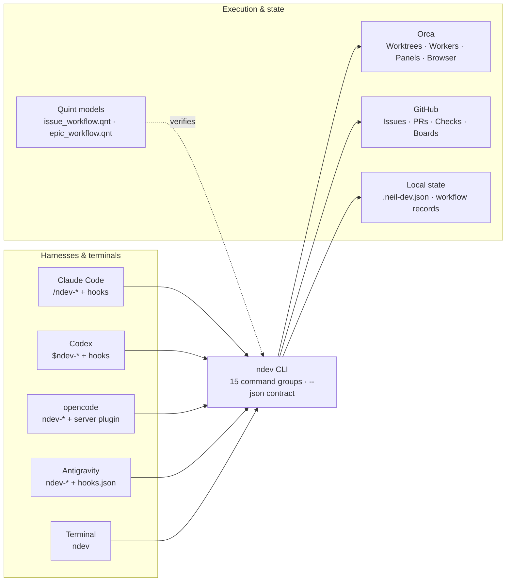
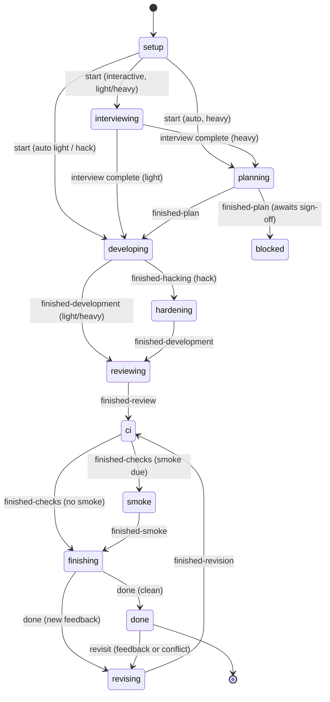
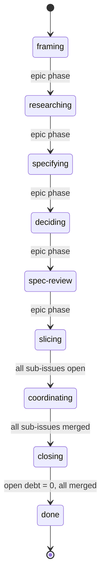
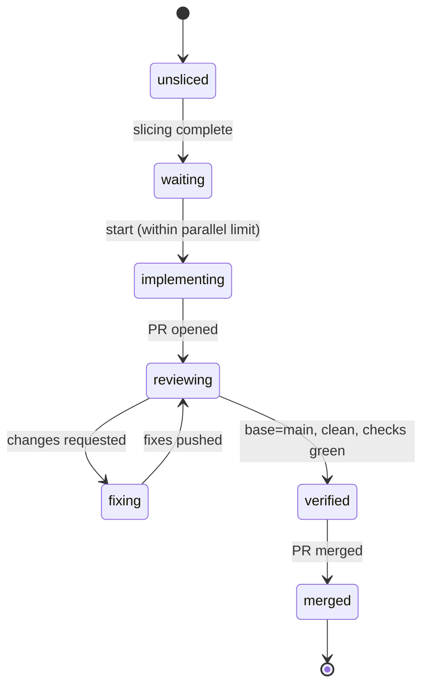

# ndev

**One CLI, installer and formally verified workflow engine for coding agents across Claude Code, Codex and opencode.**

`ndev` turns ad-hoc agent sessions into repeatable engineering workflows. It pairs one command-line tool with [Orca](https://orca.stably.ai) for worktrees, workers, browser captures and panels. It uses GitHub for issues, pull requests, checks and project boards.

[Documentation site](https://neilellis.github.io/ndev/) · [Specification](docs/ndev-2/spec.md) · [Skills index](skills/README.md) · [Agents](agents/README.md) · [Knowledge base](kb/README.md) · [Formal Quint models](models/workflow/) · [Contributing](CONTRIBUTING.md)

## Why ndev

Coding agents lose track of process on real repositories. They skip reviews, push unchecked trees, collide across branches and behave differently in each harness. `ndev` moves workflow rules out of fragile prompts into one audited CLI and shared hook layer.

| Value | What ndev does |
| --- | --- |
| **One method across harnesses** | Installs the same CLI, skills, subagents and native hooks into Claude Code, Codex and opencode. An ownership manifest updates owned files and leaves foreign files untouched. |
| **Formally verified state machines** | Issue and epic lifecycles are specified in [Quint](models/workflow/) and checked in CI. Every transition validates its preconditions and prints the exact next step. |
| **Guarded Git and pull requests** | Native pre-tool hooks block unchecked `git commit` and `git push` during active work. `ndev flow checkpoint` commits named files, runs local checks and pushes safely with lease verification. |
| **Multi-issue epic orchestration** | Coordinates sub-issues, blocker graphs, stacked pull requests, parallel worker caps and review debt across local or remote Orca hosts. |
| **Worker safety and PR queues** | `ndev triage` gates local worker launches on CPU load and requires positive exit and release proof before retry. `ndev fix-prs` repairs open PRs in a managed queue. |
| **Orca panels with CLI parity** | Shows live workflow status, files, interviews, triage, PR queues and responsive screenshot matrices in Orca panels or as plain text on headless hosts. |
| **Cost protection for native chats** | Opt-in `ndev chat-guard` blocks native Orca chat sends after 50 minutes of idle time and offers `continue`, `hand-off` or `new-session`. |

## Architecture

Every harness hook, skill, terminal command and Orca panel drives the same `ndev` binary and local state records.



## Workflows

### Single-issue workflow (`ndev flow`)

`ndev flow` tracks one issue from start to merge in an isolated worktree. Choose a **mode**: `light` for focused changes, `heavy` for planned work, or `hack` for prototypes. Choose **steering**: `interactive` for human interviews and sign-off, or `auto` for autonomous runs.



The full transition rules and 16 safety invariants live in [models/workflow/issue_workflow.qnt](models/workflow/issue_workflow.qnt).

### Multi-issue epic workflow (`ndev epic`)

`ndev epic` guides large initiatives through nine phases from framing to closing. During `coordinating`, sub-issues move through an enforced lifecycle with stacked PR support, rebase handoffs and debt tracking.



Sub-issues inside `coordinating` follow the lifecycle in [models/workflow/epic_workflow.qnt](models/workflow/epic_workflow.qnt):



### Triage and PR repair (`ndev triage`, `ndev fix-prs`)

- **`ndev triage`** loads open issues, groups related tasks and dispatches Orca workers safely. It starts one worker by default, holds starts when local 1-minute load exceeds CPU cores, and verifies worker exit and release before any retry. See [Orca worker safety](docs/ndev-2/orca-worker-safety.md).
- **`ndev fix-prs`** runs a repair queue across open PRs. Each repair worktree starts in `light` mode with `auto` steering. Pass `--no-merge` to leave green PRs for a human to merge.

## Install

Use Node.js 22.18 or later. Install Orca and make sure `orca` is on your `PATH`. For GitHub work, sign in with the GitHub CLI (`gh auth login`).

From a copy of this repository, preview the install plan before writing files:

```sh
bin/ndev install all --dry-run
bin/ndev install all
ndev install verify all
```

Use `claude`, `codex`, `opencode` or `antigravity` in place of `all` to install one profile. The default binary path is `$HOME/.local/bin/ndev`. Add `$HOME/.local/bin` to your `PATH` if necessary. In Codex, run `/hooks` to review and trust the installed hooks.

The `antigravity` profile supports Google Antigravity (the app and the `agy` CLI). It installs skills in `~/.gemini/config/skills`, agents in `~/.gemini/config/agents`, and an `ndev` hook group in `~/.gemini/config/hooks.json`. Other hook groups in that file stay unchanged. Antigravity has no session-end or compaction hook, so stop worktree stacks before leaving a session.

The Claude installer respects `CLAUDE_CONFIG_DIR` when set. If that path changes, `ndev` tracks each recorded Claude home and refreshes its hooks, skills and agents on reinstall. Copied hooks must match the ownership manifest. Skills and agents reached through directory symlinks keep their recorded ownership. Foreign hooks and files stay protected.

Pass `--panels` to install the `neilellis.ndev` Orca plugin:

```sh
ndev install claude --panels
```

If Orca asks for plugin trust, `ndev` prints the approval command with its fingerprint. Open the panel in the matching Orca workspace. Terminals and headless hosts use the CLI text view automatically.

## Set up a new project from an agent

Open the project worktree in Orca and give Claude Code, Codex, opencode or Antigravity this prompt:

> Set up ndev for this project and for the harness you are running in. Use `ndev` or `$HOME/.local/bin/ndev` if it is already installed. Otherwise use `bin/ndev` from the ndev source. If the source is missing, download and extract the archive from `gh api repos/neilellis/ndev/tarball/main` in a temporary directory. Run `install <harness> --dry-run`, then `install <harness>` and `install verify <harness>`. Replace `<harness>` with `claude`, `codex`, `opencode`, or `antigravity`.
>
> From this project's Git worktree, run `ndev project status --json` with the installed binary. If the project has no ndev GitHub settings, use its GitHub remote and run `ndev project setup --repo <owner/repo> --no-board`. Use `--board <owner/number>` if I gave you a board, or `ndev project setup --no-repo` if I said there is no GitHub repository. Ask if the remote is unclear. Read back the settings with `ndev project status` and tell me what was set up.
>
> If the project has no `NORTH_STAR.md` at the repository root, ask me to create it. I can also give you the project's purpose and guiding rules so you can draft the file for my approval. Keep the file if it already exists.

The install adds the CLI, skills and hooks to your user account. Project setup writes GitHub settings to `.neil-dev.json`. Run project setup in each new repository and start a fresh agent session after installing new skills or hooks.

## Everyday use

```sh
ndev --help
ndev project status
ndev project setup --repo owner/name --no-board
ndev flow start 42 --short-name fix-login
ndev flow status --json
ndev flow checkpoint --message "Validate input" --file src/login.ts
ndev pane view --open
```

Resume an existing open PR in an isolated checkout without creating a duplicate PR:

```sh
ndev flow start 1401 --pr 1402
```

Repair an existing local workflow that points at an alias branch or duplicate PR:

```sh
ndev flow repair --issue 1401 --pr 1402
```

`ndev flow repair` checks the open PR, issue link, origin, canonical head and local ancestry. It preserves the local branch, files, commits and canonical branch while routing future checkpoints to the canonical PR branch. Prior review, CI and smoke evidence is cleared so fresh verification runs on the resulting head. Taking over from another owner requires `--take-over` and Orca confirmation that the previous owner has finished. Repair never closes duplicate PRs or merges code.

Use `ndev wait` for one bounded blocking wait. In Orca, `ndev watch` checks the PR head and reports failed or completed checks. Use `ndev <group> --help` for the commands in any group, and `ndev <group> <command> --help` for its flags.

### Run from Codex chat

Install the Codex profile with `ndev install codex`, trust hooks with `/hooks`, and start a fresh session. Run commands directly in chat:

```text
$ndev-cli flow status
$ndev-cli pane view --open
$ndev-triage --open
$ndev-triage launch
```

`$ndev-cli` runs any `ndev` command and returns its result. `$ndev-triage` loads and groups open issues into a plan. `$ndev-triage launch` starts approved Orca workers.

## Skills, agents and documentation

- **Published docs site**: built from [docs-site/](docs-site/README.md) with Next.js static export and deployed to GitHub Pages by [.github/workflows/pages.yml](.github/workflows/pages.yml). Includes live Quint-to-Mermaid workflow diagrams and full-text search.
- **[Skills index](skills/README.md)**: lists every skill installed as `ndev-<name>`, compares related skills and records retired entry points.
- **[Agents index](agents/README.md)**: defines subagent roles, models, tools and isolation boundaries.
- **[Knowledge base](kb/README.md)**: holds the project-neutral engineering method (core beliefs, testing, guards, verification, CI, Git worktrees and house writing style).
- **[ndev 2.0 specification](docs/ndev-2/spec.md)** and **[parity list](docs/ndev-2/parity.md)**: define the CLI, hooks, installer, Orca panel protocol and migration coverage.
- **[Shared scripts](scripts/README.md)** and **[Orca panel plugin](orca-plugin/ndev/README.md)**: document shared helpers and desktop panels.

## Source, tests and formal checks

Run the native CLI, installer and panel regression suites:

```sh
npm test
```

`npm test` runs every tracked `*.test.mjs` file except those listed in `scripts/test/exceptions.json`. Set `NDEV_TEST_NATIVE_HARNESSES=1` to include native install trials when Claude Code, Codex, opencode and Antigravity are installed. Install tests use temporary homes.

Run the formal Quint checks (`typecheck`, model links and simulation tests):

```sh
scripts/ci/formal-check.sh
```

The `sdk` job in [.github/workflows/ndev.yml](.github/workflows/ndev.yml) runs the retained `*.test.ts` and `*.test.tsx` suite with `node scripts/test/sdk.mjs` on the runtime pinned in `scripts/test/sdk-runtime.json`. See [CONTRIBUTING.md](CONTRIBUTING.md) for contributor setup and plugin version guard rules.
