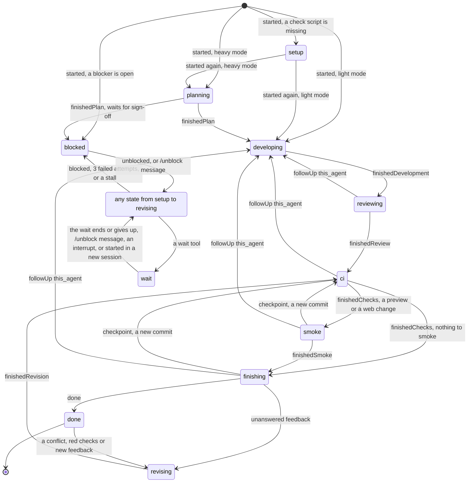
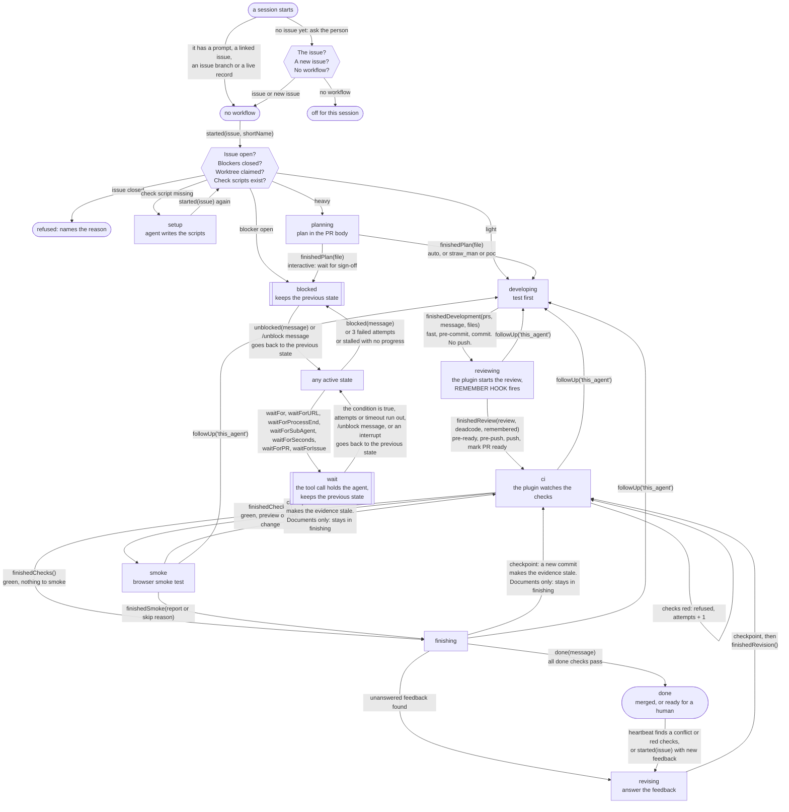

[kb](README.md) › workflow

# The workflow

**The workflow keeps an agent on one issue from start to finish, and always in a clear state.** The agent calls a tool at each phase. The tool records the state, does the mechanical work, and returns the next step. You do not need to ask "are we done?".

To read this guide in a session, type `/ndev-workflow guide`. A terminal shows the diagrams below as Mermaid source. A Markdown viewer draws them.

## The states

This diagram shows only the states and the moves between them. The flow chart below adds the checks and what each tool does.

`blocked` and `wait` each keep the previous state, and they go back to it. Thus the stage hooks do not fire again.

## The flow

The `active` node stands for each state from `setup` to `revising`.

## Tools

Each tool is `mcp__ndev__<name>`. A call in the wrong state changes nothing, and its message names the current state and the tool that is valid now.

| Tool                                                          | What it does                                                                                                                                                                  | It refuses when                                                                                                                                  |
| ------------------------------------------------------------- | ----------------------------------------------------------------------------------------------------------------------------------------------------------------------------- | ------------------------------------------------------------------------------------------------------------------------------------------------ |
| `started(issue, shortName)`                                   | Records the state, or resumes it. A new workflow needs `shortName`, and a resume does not. Claims the worktree, initialises its submodules and opens the draft PR.            | The issue is closed. Another live session owns the record.                                                                                       |
| `finishedPlan(markdown_file)`                                 | Moves the plan into the PR body, with `Closes #n`.                                                                                                                            | The plan has no `Test entry point:` line.                                                                                                        |
| `checkpoint(message, files, changeTypes)`                     | Commits the named files and pushes. In `reviewing` it holds the commit. With no files, it pushes a held commit. `changeTypes` is optional. See [Change types](#change-types). | A check script fails.                                                                                                                            |
| `finishedDevelopment(prs, message, files)`                    | Commits the named files. It does not push. Starts the code review at once, and lists the changed UI files for it.                                                             | Changed files are not named.                                                                                                                     |
| `finishedReview(review, deadcode, remembered)`                | Takes the results of the review and remember hooks. Runs `pre-ready-check.sh`, pushes, marks the PR ready.                                                                    | A field is empty. A `formal_project` sends `skipped:`. A check fails, and then nothing is pushed.                                                |
| `finishedChecks()`                                            | Reads the checks of HEAD.                                                                                                                                                     | Checks are pending or red. HEAD is not pushed.                                                                                                   |
| `finishedSmoke(report)`                                       | Records the smoke test on HEAD.                                                                                                                                               | HEAD is not in the report. A `formal_project` sends `skipped:`.                                                                                  |
| `finishedRevision()`                                          | Goes back to `ci` after you answer the feedback.                                                                                                                              | Feedback has no answer.                                                                                                                          |
| `blocked(message)`                                            | Sends a notification that stays until you dismiss it, and flags the Orca worktree.                                                                                            | It is already blocked.                                                                                                                           |
| `unblocked(message)`                                          | Removes the notification and the flag, and goes back to the previous state.                                                                                                   | It is not blocked.                                                                                                                               |
| `waitForSubAgent(claude_agent_id, period, attempts, timeout)` | Holds the agent until the subagent ends.                                                                                                                                      | See [Wait tools](#wait-tools).                                                                                                                   |
| `waitForURL(url, period, attempts, timeout)`                  | Holds the agent until the URL answers with a 2xx status.                                                                                                                      | See [Wait tools](#wait-tools). The URL is not http or https.                                                                                     |
| `waitForProcessEnd(pid, period, attempts, timeout)`           | Holds the agent until the process ends. It cannot read the exit code.                                                                                                         | See [Wait tools](#wait-tools).                                                                                                                   |
| `waitForSeconds(secs, attempts, timeout)`                     | Holds the agent for this time. `attempts` has no effect, because no check runs.                                                                                               | See [Wa/ndeit tools](#wait-tools).                                                                                                               |
| `waitFor(shell_command, period, attempts, timeout)`           | Runs the command every `period` seconds (30 by default), in the worktree, until it exits 0. Each run may last 60 s.                                                           | See [Wait tools](#wait-tools).                                                                                                                   |
| `waitForPR(pr, state, period, attempts, timeout)`             | Holds the agent until the PR is `open`, `closed`, `merged`, `draft`, `ready` or `mergeable`. It does not wait for checks, because the workflow watches those.                 | See [Wait tools](#wait-tools). The state is not on this list. `period` is less than 60.                                                          |
| `waitForIssue(issue, state, period, attempts, timeout)`       | Holds the agent until the issue is `open` or `closed`.                                                                                                                        | See [Wait tools](#wait-tools). The state is not on this list. `period` is less than 60.                                                          |
| `done(message, remembered)`                                   | Runs the done checks. It needs `remembered` only when a human skipped the review stage. Merges if the project level allows it.                                                | `remembered` is empty. A check fails, and then the message lists each problem.                                                                   |
| `followUp(mode, message)`                                     | Creates an issue, then acts by mode.                                                                                                                                          | After `done`, only `issue_only` is allowed.                                                                                                      |
| `addMigration(name)`                                          | Makes the empty migration file and lists it in the PR body, to run after the merge.                                                                                           | The name holds other than lower-case letters, digits and underscores. The workflow has no PR. The state is `setup`, `done`, `blocked` or `wait`. |
| `requestSecret(name)`                                         | Says where a secret is: the file and the line. It never returns the value.                                                                                                    | Never. A secret that it cannot find is reported.                                                                                                 |
| `iNeedA(kind, description)`                                   | Gives guidance before the agent chooses a thing. The kinds are `react-component`, `library`, `brand-style` and `animation`.                                                   | The kind is not one of these.                                                                                                                    |
| `reportWorkflowBug(title, details)`                           | Starts an Orca agent that fixes a fault of the plugin on its `main`.                                                                                                          | The limit of 5 agents in 24 hours is reached. Orca cannot start the agent.                                                                       |
| `screenshot(url, viewports, schemes, fullPage, waitSeconds)`  | Takes images of a page in the Orca browser and gives their full paths. See [Change types](#change-types). A helper can also call it.                                          | Orca does not run. The page goes to a login page. A viewport or a scheme is not valid.                                                           |
| `status()`                                                    | Shows the state and the next step. It changes nothing.                                                                                                                        | Never.                                                                                                                                           |

Each next step tells the agent not to ask permission for a step that the plan already allows, and to call `blocked` for a question that only the human can answer. A question at the end of a turn stops the work until the human answers it.

A helper agent can call only `status`, `requestSecret`, `followUp('issue_only')`, `iNeedA`, `reportWorkflowBug` and `screenshot`. A helper does not move the state of the main agent.

`followUp('subagent')` claims a worktree for the new issue and writes a record there, then starts the agent in that worktree. That agent commits and pushes with `checkpoint(message, files, worktree)`. This runs the check scripts of its own worktree and does not touch the main workflow. If that worktree has no check scripts, for example because the base branch does not have them yet, `checkpoint` commits nothing and tells the agent to write them. A raw `git commit` or `git push` by that agent is refused while the main workflow owns the checks. After the main workflow is `done` or off, the guard stands aside, so `checkpoint` is then the agent's own rule.

Each skill and agent of the plugin names the tools that it needs. `scripts/workflow/tests/skills_name_workflow.test.mjs` checks this, and it checks that each named tool exists.

## Stage hooks

A stage hook is work that a change of state sets off. The hooks are in the tools, not in Claude Code settings. The function that changes the state fires them, so a tool, the heartbeat and a human skip all fire them in the same way. The next-step text carries the hook, so it survives compaction, and `status` shows it. The record keeps when each hook fired and the result it took.

| Hook       | Fires when the state enters | It tells the agent to                                                                                                                                                                                                                    | Result taken by                   |
| ---------- | --------------------------- | ---------------------------------------------------------------------------------------------------------------------------------------------------------------------------------------------------------------------------------------- | --------------------------------- |
| `review`   | `reviewing`                 | `finishedDevelopment` starts the `ndev:diff-reviewer` agent itself. Its answer comes back as a prompt and stays in the record. A resume starts it again if a restart lost it. The agent fixes the findings and runs the dead-code sweep. | `finishedReview`                  |
| `remember` | `reviewing`                 | The main agent records what the work taught (`ndev:remember`), updates the documents it made wrong (`ndev:docs-sync`), and runs the dev-wiki ingest. A subagent cannot do this, because it does not know the session.                    | `finishedReview`, as `remembered` |

A return from `blocked` or `wait` does not fire a hook again, because the stage only continues.

These hooks are part of the state machine, not external hooks. The review starts inside `finishedDevelopment`. The tool does not push the finished work until the agent reports a review result and a remember result. Commits made through `checkpoint` during `developing` go to the draft PR before this, so that a crash does not lose them.

Commits made while `developing` go to the draft PR, so a crash does not lose them. The last commit of development and each fix made during the review stay local until `finishedReview`.

## Checks

The engine runs git with the repository's hooks off, so the tools run the checks. Each project keeps its checks in `scripts/ndev/workflow/`. `started` looks for each script. If one is missing, the state is `setup`, and the reply tells the agent what each script must do.

| Script                   | When it runs                            | What it runs                                                                                                             |
| ------------------------ | --------------------------------------- | ------------------------------------------------------------------------------------------------------------------------ |
| `fast-checks.sh <files>` | Before each commit, on the staged files | Only very fast Rust tools, such as ruff, ty and oxlint. Copy `scripts/workflow/fast-checks-template.sh` from the plugin. |
| `pre-commit-check.sh`    | Before each commit                      | Full lint and typecheck                                                                                                  |
| `pre-push-check.sh`      | Before each push                        | Unit tests                                                                                                               |
| `pre-ready-check.sh`     | Before the PR leaves draft              | The full suite and E2E                                                                                                   |

A failed script stops the tool. The message gives the script, the exit code and the last lines of output. When the base branch has the script, the tool runs the base version, so a branch cannot weaken its own check.

## What the workflow took over from the hooks

While a workflow runs in a worktree, these hooks stand aside, and the workflow does their work:

| Hook                | Now done by                                                                                          |
| ------------------- | ---------------------------------------------------------------------------------------------------- |
| Edited-file guards  | `fast-checks.sh` at each commit. The `developing` step tells the agent to run it for a quick answer. |
| Precheck reminder   | The tools run the check scripts themselves.                                                          |
| Component check     | `finishedDevelopment` lists the changed UI files for the review.                                     |
| Ingest after a push | The `remember` hook.                                                                                 |
| Worktree submodules | `started`, when it claims the worktree. The hook stays for a manual `git worktree add`.              |

The hooks still run when there is no workflow, in `setup`, after a human skips `setup`, when the workflow is off, and in `done`. The subscription warning stays a hook, because no stage matches it.

## Project level

Set `projectLevel` in `.neil-dev.json`. A project with no level behaves as `small_project`.

| Level            | The agent can merge a PR | The agent can commit to the base branch | Plan sign-off    | Review and smoke can be skipped |
| ---------------- | ------------------------ | --------------------------------------- | ---------------- | ------------------------------- |
| `straw_man`      | Yes                      | Yes, with no PR or worktree             | No               | Yes                             |
| `poc`            | Yes                      | No                                      | No               | Yes                             |
| `small_project`  | No                       | No                                      | When interactive | Yes                             |
| `formal_project` | No                       | No                                      | When interactive | No                              |

A migration file in the change that `addMigration` does not list is named at `finishedDevelopment`, and `done` refuses it, because nothing will run it after the merge. A human who knows that CI runs it can go on with `/ndev-workflow goto done`.

When the agent can merge, `done` merges the PR. A PR with migrations is not merged by `done`: the reply tells the agent to load `ndev:merge`, which merges the PR and then runs the migrations.

## Mode and steering

| Step       | light                             | heavy                                                                                                                  |
| ---------- | --------------------------------- | ---------------------------------------------------------------------------------------------------------------------- |
| Plan       | Skipped                           | Required, in the PR body                                                                                               |
| Review     | One reviewer that the tool starts | Two reviewers that the tool starts: one for standards, one for the specification. A change of documents only gets one. |
| `gates.sh` | Not run                           | Run at `finishedDevelopment`                                                                                           |

| Point          | interactive                      | auto                |
| -------------- | -------------------------------- | ------------------- |
| After the plan | Blocks until the human signs off | Continues           |
| At each phase  | The agent reports the checkpoint | The agent continues |

## When a session starts with no issue

A person who starts a session with no issue gets one question, with three answers:

| Answer      | What happens                                                                                                                |
| ----------- | --------------------------------------------------------------------------------------------------------------------------- |
| The issue   | The prompt box gets `Work on issue #`, and the person adds the number. A typed number or issue URL starts the work at once. |
| A new issue | The prompt box gets `/ndev:issue` . A typed description files the issue and starts the work at once.                        |
| No workflow | The tools and the reminders stay off for this session. `/ndev-workflow on` turns them back on.                              |

There is no question when the session already has work: a first prompt, a linked Orca issue, a branch that names an issue, or a live record. Thus a worker that runs alone does not stop here. The plugin waits 3 seconds for a first prompt. A worker can meet the question only when its prompt comes later than that. It must also have no link and no issue in its branch.

## iNeedA

`iNeedA(kind, description)` is how an agent asks for guidance. The aim is to keep the work to a fixed set of libraries and components, and not to forbid others. The agent can choose otherwise and say why.

| Kind              | What the plugin reads                                                                           | What the answer gives                                                   |
| ----------------- | ----------------------------------------------------------------------------------------------- | ----------------------------------------------------------------------- |
| `react-component` | `kb/ui-components.md`                                                                           | Suggestions, and where to get them                                      |
| `library`         | `kb/libraries.md` and the dependencies of the project                                           | Suggestions, and where to get them                                      |
| `brand-style`     | The tokens of the local brand site, or else the brand page, from `branding` in `.neil-dev.json` | The call on a font, a colour and so on                                  |
| `animation`       | The `motion` skill of the plugin                                                                | An idea for a micro-interaction, a simple animation or a full showy one |

A Haiku model in the plugin reads the source and answers.

## reportWorkflowBug

When the plugin does something wrong, `reportWorkflowBug(title, details)` starts an Orca agent in the plugin's own checkout. That agent works test first on `main`, commits there, and does not push. The tool also runs by itself when a workflow tool or the idle check meets an unexpected fault. An outside failure, such as a rate limit or a network error, does not start an agent.

The same title starts no second agent for 24 hours. At most 5 agents start in 24 hours. A refusal that is correct and a bug in the project are not workflow bugs.

## Staying on track

The workflow works like `/goal`. When the agent ends a turn and the workflow is not finished, the plugin prompts it again with the state and the next step. It does not prompt when:

- the prompt box holds a draft
- a helper agent runs
- another session owns the record
- the state is `blocked` or `wait`, or the workflow is off

If the state, HEAD, the tree and the PR problems stay the same over 3 reminders, the workflow goes to `blocked`. Thus an agent cannot spend tokens all night, and you get a notification.

### Heartbeat

After 20 minutes with no activity, the plugin compacts the session and prompts the agent again. Before it prompts, it reads the PR. It tells the agent about a merge conflict or red checks. An idle session that still makes no progress after one reminder goes to `blocked`.

The heartbeat also watches a `done` PR until the PR merges. A clean PR makes no prompt and no compaction. A conflict or red checks moves the state to `revising`, and the agent is prompted. A PR that closes in an active state blocks the workflow.

A session that has died does not restart, because the heartbeat runs inside the session. A new session resumes with `started`.

A resumed session (`claude --resume`) finds its workflow itself. At start it reads the worktrees of the repository, and it takes the one that it owns or last released. A session that never had the workflow does not take it.

### The checks

In `ci` the agent starts no wait of its own. The plugin watches the checks for it, so the turn can end with nothing open.

- Every 3 minutes, the plugin reads the PR and the checks of HEAD (`NDEV_WORKFLOW_CHECK_MS` changes the time). It reads only when the session is idle, no person is typing and no helper runs.
- A failed check or a merge conflict prompts the agent at once, with the name of each check, even when other checks still run.
- When the checks end and none failed, the prompt tells the agent to call `finishedChecks`.
- Pending checks make no prompt. After 60 minutes with no activity, the agent gets a prompt that names them. After a second period, the workflow goes to `blocked`.
- The same failure with no progress after 3 prompts also goes to `blocked`.
- A failed read of GitHub shows a toast and waits for the next period. It is not taken as a pass.

The tools refuse a wait of the agent's own while the plugin watches: `wait-for-pr-change.sh`, `wait-for-run.sh`, `gh run watch` and `gh pr checks --watch`. One read of the checks stays allowed. The same watch runs in `finishing` when pending checks refuse `done`, and its prompt says to call `done`.

In every other state, the 20-minute heartbeat is what reads the PR. A session that has died watches nothing until a new session calls `started`.

### GitHub calls

GitHub calls are limited, so the workflow makes as few as it can:

- The end of a turn makes no GitHub call.
- An idle check makes one read of the PR. Only a PR that is not clean costs one more read, of its checks.
- While checks run, each 3-minute read costs two calls, and one more for each further PR that the workflow holds. This replaces the 2-minute poll of the agent's own wait helper.
- `blocked` and off make no calls. A `done` workflow stops when its PR closes.
- All of it goes through `scripts/github/gh.sh`: the `gh` command first, and REST when that fails. `gh` commands spend GraphQL points and `gh api` spends REST calls, so one route still answers when the other is used up. `board.sh` uses GraphQL when the project has a board.

To see where a session is in the flow, type `/view`. It draws the flow as a chain of boxes: ✔ passed, ● current, ▲ blocked, ◷ waiting, ○ to come, – skipped. `revising` shows as a side loop back to `ci`.

## blocked

`blocked` runs `scripts/workflow/notify.sh`. It shows an `alerter` notification that stays until you dismiss it. A click on it opens the Orca terminal of the worktree. It also sets a comment and the unread flag on the Orca worktree. To install `alerter`: `brew install vjeantet/tap/alerter`. If `alerter` is missing, the Orca flag still appears, and the reply gives the install command.

To end a block with your answer, type `/unblock <message>`. The message is compulsory. The agent gets it in a prompt, with the next step. With no message, the command changes nothing and shows the block message. The notification and the flag are withdrawn.

## Wait tools

A wait tool holds the agent inside one tool call, so the agent cannot go on and spends no tokens. The state is `wait`, and the record keeps the previous state and what the wait is for. When the wait ends, the state goes back, and the answer gives the next step.

| Input      | Meaning                   | Default                                                                                                    |
| ---------- | ------------------------- | ---------------------------------------------------------------------------------------------------------- |
| `period`   | Seconds between checks.   | 30 for `waitFor`, 300 for `waitForPR` and `waitForIssue` (each check is one GitHub read), 5 for the others |
| `attempts` | The most checks.          | As many as the timeout allows                                                                              |
| `timeout`  | The most seconds to wait. | 3600                                                                                                       |

A wait ends in one of these ways:

| Event                                | The answer to the agent                                                                 |
| ------------------------------------ | --------------------------------------------------------------------------------------- |
| The condition is true                | The result of the last check, and the next step.                                        |
| `attempts` or `timeout` run out      | An error that names the attempts, the last exit code and its output, and the next step. |
| The human types `/unblock <message>` | The message, and the next step.                                                         |
| The human interrupts the turn        | An error that says so. The state goes back at the next check, at most 2 seconds later.  |

- A check always runs at the deadline, so a wait that ends at its timeout does not fail.
- A wait stops early if the host's time budget for one hook is nearly spent, and the error says to call the tool again.
- `/unblock` runs at once, also during a turn. `/ndev-workflow unblock` and the other `/ndev-workflow` commands run after the turn, so they cannot end a wait that is running.
- While the state is `wait`, the other phase tools refuse and no reminder comes. The reason is that the agent is not idle. `status` still answers.
- Only the main agent can call a wait tool, because a helper does not move the state.
- A session that dies or reloads during a wait leaves the state `wait` in the record, and no reminder comes. The next `started` goes back to the previous state. `/unblock <message>` also does this, and it prompts the agent with the message.
- `waitFor` runs the command that the agent gives, with the same rights as the Bash tool.
- A wait that passes half of its retries tells the human as `blocked` does: a persistent notification and the Orca flag. The retries are `attempts`, or as many as `timeout` allows at this `period`. Half of `timeout` counts too. The wait goes on, and it withdraws the notice when it ends. `waitForSeconds` has no retries, so it never does this.
- In `ci`, the plugin still watches the checks. Use a wait tool for something else, not for the checks.

The plugin pauses with a short `sleep` process and not with `$.clock.sleep`. A hook has 10 seconds of its own time, and a `$.clock` wait uses that time, but a `$.process.run` call does not.

## Orca

In an Orca workspace, each save of the state updates the workspace. Tools, the heartbeat and `/ndev-workflow` all go through that one step.

- **Name:** the workspace is `<issue>-<shortName>`, such as `7-add-sub`. The agent chooses `shortName` from the issue when it calls `started`, and the record keeps it. A project that commits to its base branch keeps the name of its main checkout.
- **Status:** see the table below. A block keeps the status that the work had.
- **Comment:** the state and what happens in it, the block message, what a wait is for, or the message of `done`. This replaces any earlier comment. For example, `/orca-triage` sets the title of the issue there.
- **Links:** the issue and the first PR.
- **Unread dot:** set when the work is blocked or done, because a human must act. Cleared when the work goes on. A wait does not set it, because no human must act.

| Workflow                                      | Orca status   |
| --------------------------------------------- | ------------- |
| `setup` to `finishing`, `revising` and `wait` | `in-progress` |
| `done`, not merged                            | `in-review`   |
| Merged                                        | `completed`   |

- The plugin sends only what changed, and these calls go to the local Orca, not to GitHub.
- A failed Orca call shows a toast with its output and does not stop the tool. The next save sends it again.
- The sync goes one way. If a human moves a workspace on the board, the plugin does not read that. The next change of status sets the column again.
- The status ids are the default board columns of Orca. A board with other ids shows the failure in the toast.
- A merge by a human reaches `completed` at the next 20-minute heartbeat, while the session is open.

## followUp

| Mode             | Result                                                                                                   |
| ---------------- | -------------------------------------------------------------------------------------------------------- |
| `this_agent`     | A sub-issue that this PR closes. The state goes back to `developing`, because the evidence is now stale. |
| `subagent`       | A new issue, and the reply tells the agent to start `issue-implementer` in its own worktree.             |
| `orca_workspace` | A new issue, and a new Orca workspace with an agent on it.                                               |
| `issue_only`     | A new issue only.                                                                                        |

## /ndev-workflow

The name is `/ndev-workflow`, not `/ndev:workflow` or `/workflow`. The engine refuses a colon in a command that a plugin registers, and the Vercel plugin owns `workflow`. `status` also shows the last thing that the heartbeat did and how long ago.

| Command                                     | What it does                                                                                                              |
| ------------------------------------------- | ------------------------------------------------------------------------------------------------------------------------- |
| `/ndev-workflow guide`                      | Shows this guide.                                                                                                         |
| `/ndev-workflow status`                     | Shows the state and the next step.                                                                                        |
| `/ndev-workflow skip [reason]`              | Leaves the current phase and goes to the next one. The PR records the reason.                                             |
| `/ndev-workflow goto <state> [reason]`      | Goes to a named state. The PR records the reason.                                                                         |
| `/unblock <message>`                        | Gives the agent your answer and ends `blocked` or `wait`. The message is compulsory. It runs at once, also during a turn. |
| `/ndev-workflow unblock [message]`          | Ends `blocked`, for when the agent does not. The message is optional. It runs after the turn.                             |
| `/ndev-workflow off [reason]` / `on`        | Turns the tools and the reminders of this worktree off or on. The record stays.                                           |
| `/ndev-workflow off project` / `on project` | Does the same for the whole project, in `.neil-dev.json`.                                                                 |

If you skip `reviewing`, the held commit is not pushed yet. The agent pushes it with `checkpoint` and no files, and `finishedChecks` tells it to do this.

## Change types

The review instructions change with the types of the change. The types are `web`, `backend`, `database`, `docs`, `tests` and `config`. Each type adds its own text to the review.

`checkpoint` and `finishedDevelopment` take an optional `changeTypes` list. A value that is not on this list stops the call before a commit.

The tool always reads the types from the local diff too, and it adds them to the types that you give. Thus an agent that names too few types does not get the short review. An empty list is not an error. The record keeps the result in `changeTypes` and the web files in `webFiles`. These types only accumulate. A call does not remove a type. This read does not use GitHub.

If git cannot read the diff, the record has `typesUnread`. Then the review is the full review. The repair is `git fetch origin <base>`. The next read that succeeds clears `typesUnread`.

| Type       | What the review adds                                                                                                                                                                                                                                                      |
| ---------- | ------------------------------------------------------------------------------------------------------------------------------------------------------------------------------------------------------------------------------------------------------------------------- |
| `web`      | The agent takes images with `screenshot` from a local dev server. It takes the changed pages, at 390x844, 820x1180 and 1440x900, in light and in dark. It reads each image. A web change also goes to the smoke stage, and the smoke step asks for images of the preview. |
| `backend`  | The reviewer checks the error paths, input validation, authorisation, concurrency and each caller of a changed interface.                                                                                                                                                 |
| `database` | The agent applies each new migration to a local database and runs the tests. The reviewer checks locks, the order against the deployed code, the way back, indexes and row-level security.                                                                                |
| `docs`     | The reviewer checks each changed claim against the code in the diff. If all types are `docs`, the review is shorter: no dead-code sweep, and `deadcode` is `none: documents only`.                                                                                        |
| `tests`    | The reviewer checks that each new test fails when the defect returns, that no assertion became weaker, and that only external boundaries are mocked.                                                                                                                      |
| `config`   | The reviewer checks the effect on the checks, the build and the deployment, each new dependency, and that the diff has no secret and no turned-off check.                                                                                                                 |

The commit is held in `reviewing`, so no preview exists at that time. This is why the review uses a local dev server.

`screenshot` drives the Orca browser, not Chrome. It opens its own tab, sets each scheme and each viewport, checks that the page took them, saves the images and closes the tab. The images go in `<git folder>/ndev-screenshots/<sha>/`. They are in no commit and do not reach the PR, so the result must say what the agent saw. If the page goes to a login page, the tool saves nothing and keeps the tab open, so the human can sign in once. Orca that does not run gives a refusal that names `orca open`.

## The record

The state is in `.neil-dev.worktree.json`, under the `workflow` key. `scripts/work/worktree_env.mjs` is the only writer. It uses a lock and a revision number, so a stale writer fails and does not overwrite. `/view` shows the state of the worktree.

The record must stay out of git. `set-workflow` adds the line to `info/exclude` of the repository by itself, so the workflow tools start in any project. It refuses a record that git tracks and names `git rm --cached` as the repair. It also refuses when a `.gitignore` un-ignores the record.

## Rules that the tools enforce

While the workflow owns the checks, a raw `git commit` or `git push` is refused. Use `checkpoint`, also to end a merge. With no files, `checkpoint` pushes a held commit. The rule does not apply in `setup`, in `done`, when the workflow is off, or when a human skipped the setup of the check scripts.

A retry commits each file that it names. If the last try stopped after its commit, and a tracked file changed after that commit, the tool refuses until you name the file. So the push cannot send a commit without its fix.

A commit that changes only documents keeps the evidence. The tool reads the changed paths from git. It does not use the names in the call.

GitHub lists no checks just after a push. With `.github/workflows`, `finishedChecks` waits up to 10 minutes after the commit for a first check. Without that folder, it waits up to 2 minutes. After that time, the tool takes it that the repository runs no check for this commit.

`done` and `started` treat each human comment after the last `finishedRevision` as new feedback. A commit for another reason does not answer a comment. If no `finishedRevision` was called, the time is the time that the PR opened.

A workflow with no PR cannot move: each tool that needs the PR names `started`, which opens it. `/ndev-workflow goto done` refuses when there is no PR, or when a commit is not pushed.