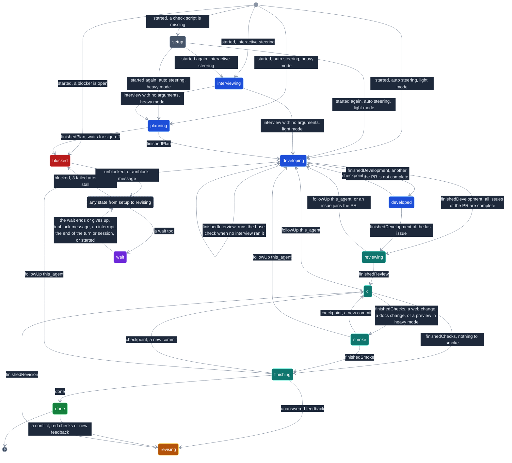
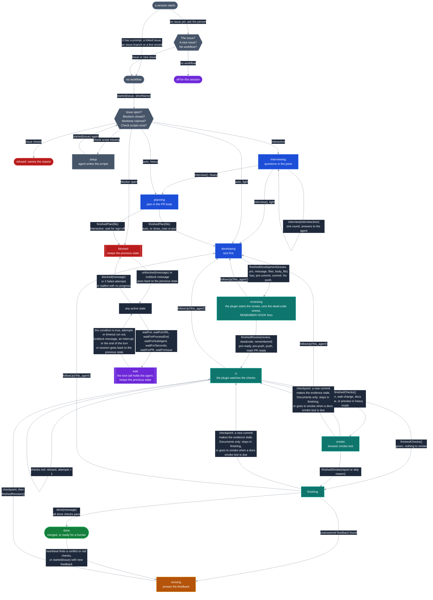

[kb](README.md) › workflow

# The workflow

**The workflow keeps an agent on one issue from start to finish, and always in a clear state.** The agent calls a tool at each phase. The tool records the state, does the mechanical work, and returns the next step. You do not need to ask "are we done?".

To read this guide in a session, type `/flow guide`. A terminal shows the diagrams below as Mermaid source. A Markdown viewer draws them.

## The states

This diagram shows only the states and the moves between them. The flow chart below adds the checks and what each tool does.

The colours are the same in both diagrams: grey is the start, blue is the work, teal is the verification, amber is a revision, green is done, red is a stop and purple is a hold. The dashed box stands for any active state.



`blocked` and `wait` each keep the previous state, and they go back to it. Thus the stage hooks do not fire again.

## The flow



The `active` node stands for each state from `setup` to `revising`.

## Tools

Each tool is `mcp__ndev__<name>`. A call in the wrong state changes nothing, and its message names the current state and the tool that is valid now.


| Tool                                                          | What it does                                                                                                                                                                  | It refuses when                                                                                                                                  |
| ------------------------------------------------------------- | ----------------------------------------------------------------------------------------------------------------------------------------------------------------------------- | ------------------------------------------------------------------------------------------------------------------------------------------------ |
| `started(issue, shortName, mode)`                                   | Records the state, or resumes it. A new workflow needs `shortName`, and a resume does not. Claims the worktree, initialises its submodules and opens the draft PR.            | The issue is closed. Another live session owns the record.                                                                                       |
| `create(shortName, description, mode)` | Files a new issue and calls `started` for it. The answer gives the issue number. It adds no board card. |
| `comment(issue or pr, message)` | Adds a comment to the issue or the PR. It works with or without a workflow. |
| `interview(interviewJson)` | With `interviewJson`, shows one round in the interview pane, holds until the human answers, and returns the answers and notes. With no arguments, ends the interview and goes on. See [The interview](#the-interview). |
| `setSteering(steering, reason)` | Sets the steering to `auto` when no human can answer. It goes one way only. The reason goes on the issue and the PR, with a notification. In `interviewing`, it also goes on. |
| `finishedPlan(issue, markdown_file)`                                 | Moves the plan into the PR body, with `Closes #n`.                                                                                                                            | The plan has no `Test entry point:` line.                                                                                                        |
| `hotfix(shortName, description, issue)` | Files an issue for an urgent fix, and gives it its own worktree and draft PR, with the workflow off there. The answer gives the hotfix instructions. See [hotfix](#hotfix). |
| `finishedInterview(issue)` | For an issue that did not leave an interview, such as under auto steering. Runs the base check and records the result. Valid only in `developing`. It can run again. `checkpoint` and `finishedDevelopment` refuse until it has run. See [Checks](#checks). |
| `checkpoint(issue or pr, message, files, changeTypes)`                     | Commits the named files and pushes. In `reviewing` it holds the commit. With no files, it pushes a held commit. `changeTypes` is optional. See [Change types](#change-types). | A check script fails.                                                                                                                            |
| `finishedDevelopment(issues, prs, message, files, body_file)`                    | Commits the named files for the listed issues. An optional `body_file` goes in its own section of the PR body, so the plan and its sign-off stay. A missing file refuses before the commit. It does not push. When each issue of the PR is complete, it starts the code review and lists the changed UI files. Until then, the listed issues wait in `developed`.                                                             | Changed files are not named.                                                                                                                     |
| `finishedReview(issue or pr, review, deadcode, remembered)`                | Takes the results of the review and remember hooks. Runs `pre-ready-check.sh`, pushes, marks the PR ready.                                                                    | A field is empty. A `formal_project` sends `skipped:`. A check fails, and then nothing is pushed.                                                |
| `finishedChecks(issue or pr)`                                            | Reads the checks of HEAD.                                                                                                                                                     | Checks are pending or red. HEAD is not pushed.                                                                                                   |
| `finishedSmoke(issue or pr, report)`                                       | Records the smoke test on HEAD.                                                                                                                                               | HEAD is not in the report. A `formal_project` sends `skipped:`.                                                                                  |
| `finishedRevision(issue or pr)`                                          | Goes back to `ci` after you answer the feedback.                                                                                                                              | Feedback has no answer.                                                                                                                          |
| `blocked(issue or pr, message)`                                            | Sends a notification that stays until you dismiss it, and flags the Orca worktree.                                                                                            | It is already blocked.                                                                                                                           |
| `unblocked(issue or pr, message)`                                          | Removes the notification and the flag, and goes back to the previous state.                                                                                                   | It is not blocked.                                                                                                                               |
| `waitForSubAgent(issue or pr, claude_agent_id, period, attempts, timeout)` | Holds the agent until the subagent ends.                                                                                                                                      | See [Wait tools](#wait-tools).                                                                                                                   |
| `waitForURL(issue or pr, url, period, attempts, timeout)`                  | Holds the agent until the URL answers with a 2xx status.                                                                                                                      | See [Wait tools](#wait-tools). The URL is not http or https.                                                                                     |
| `waitForProcessEnd(issue or pr, pid, period, attempts, timeout)`           | Holds the agent until the process ends. It cannot read the exit code.                                                                                                         | See [Wait tools](#wait-tools).                                                                                                                   |
| `waitForSeconds(issue or pr, secs, attempts, timeout)`                     | Holds the agent for this time. `attempts` has no effect, because no check runs.                                                                                               | See [Wait tools](#wait-tools).                                                                                                               |
| `waitFor(issue or pr, shell_command, period, attempts, timeout)`           | Runs the command every `period` seconds (30 by default), in the worktree, until it exits 0. Each run may last 60 s.                                                           | See [Wait tools](#wait-tools).                                                                                                                   |
| `waitForPR(issue, pr, state, period, attempts, timeout)`             | Holds the agent until the PR is `open`, `closed`, `merged`, `draft`, `ready` or `mergeable`. It does not wait for checks, because the workflow watches those.                 | See [Wait tools](#wait-tools). The state is not on this list. `period` is less than 60.                                                          |
| `waitForIssue(issue or pr, waitOn, state, period, attempts, timeout)`       | Holds the agent until each issue in the list `waitOn` is `open` or `closed`.                                                                                                                        | See [Wait tools](#wait-tools). The state is not on this list. `period` is less than 60.                                                          |
| `done(issue or pr, message, remembered)`                                   | Runs the done checks. It needs `remembered` only when a human skipped the review stage. Merges if the project level allows it. Stops the stacks and dev servers of the worktree, and leaves the worktree to Orca. If the settings file has an error, it stops nothing and names the repair.                                                | `remembered` is empty. A check fails, and then the message lists each problem.                                                                   |
| `followUp(issue or pr, mode, message)`                                     | Creates an issue, then acts by mode.                                                                                                                                          | After `done`, only `issue_only` is allowed.                                                                                                      |
| `addMigration(issue or pr, name)`                                          | Makes the empty migration file and lists it in the PR body, to run after the merge.                                                                                           | The name holds other than lower-case letters, digits and underscores. The workflow has no PR. The state is `setup`, `done`, `blocked` or `wait`. |
| `requestSecret(name)`                                         | Says where a secret is: the file and the line. It never returns the value.                                                                                                    | Never. A secret that it cannot find is reported.                                                                                                 |
| `iNeedA(kind, description)`                                   | Gives guidance before the agent chooses a thing. The kinds are `react-component`, `library`, `brand-style` and `animation`.                                                   | The kind is not one of these.                                                                                                                    |
| `reportWorkflowBug(title, details)`                           | Starts an Orca agent that fixes a fault of the plugin on its `main`.                                                                                                          | The limit of 5 agents in 24 hours is reached. Orca cannot start the agent.                                                                       |
| `screenshot(url, viewports, schemes, fullPage, waitSeconds)`  | Takes images of a page in the Orca browser and gives their full paths. See [Change types](#change-types). A helper can also call it.                                          | Orca does not run. The page goes to a login page. A viewport or a scheme is not valid.                                                           |
| `status(issue or pr)`                                                    | Shows the state and the next step. It changes nothing.                                                                                                                        | Never.                                                                                                                                           |


Give each call the thing that it works on. A call for development gives `issue`. A call from `reviewing` onward can give `pr`, or an issue that the PR carries. See [The issue and the PR](#the-issue-and-the-pr).

Each next step tells the agent not to ask permission for a step that the plan already allows, and to call `blocked` for a question that only the human can answer. A question at the end of a turn stops the work until the human answers it.

A helper agent can call only `status`, `requestSecret`, `followUp('issue_only')`, `iNeedA`, `reportWorkflowBug` and `screenshot`. A helper does not move the state of the main agent.

`followUp('subagent')` claims a worktree for the new issue and writes a record there, then starts the agent in that worktree. That agent commits and pushes with `checkpoint(message, files, worktree)`. This runs the check scripts of its own worktree and does not touch the main workflow. If that worktree has no check scripts, for example because the base branch does not have them yet, `checkpoint` commits nothing and tells the agent to write them. A raw `git commit` or `git push` by that agent is refused while the main workflow owns the checks. After the main workflow is `done` or off, the guard stands aside, so `checkpoint` is then the agent's own rule.

Each skill and agent of the plugin names the tools that it needs. `scripts/workflow/tests/skills_name_workflow.test.mjs` checks this, and it checks that each named tool exists.

## Stage hooks

A stage hook is work that a change of state sets off. The hooks are in the tools, not in Claude Code settings. The function that changes the state fires them, so a tool, the heartbeat and a human skip all fire them in the same way. The next-step text carries the hook, so it survives compaction, and `status` shows it. The record keeps when each hook fired and the result it took.


| Hook       | Fires when the state enters | It tells the agent to                                                                                                                                                                                                                    | Result taken by                   |
| ---------- | --------------------------- | ---------------------------------------------------------------------------------------------------------------------------------------------------------------------------------------------------------------------------------------- | --------------------------------- |
| `review` | `reviewing`                 | `finishedDevelopment` starts the `ndev:diff-reviewer` agent itself. Its answer comes back as a prompt and stays in the record. A resume starts it again if a restart lost it. The agent fixes the findings. |
| dead-code sweep | `reviewing`                 | `finishedDevelopment` and `/flow goto reviewing` run the sweep of each language, before the reviewers start, that the change holds: `sweep.sh` for Python, over all tracked roots, and `sweep-ts.sh` for TypeScript. The result is in the answer. Findings do not stop the review. An exit code of 2 is reported as "did not measure", and it is not a pass. A resume runs a sweep that a restart lost. The sweep does not run again for later commits. The agent gives the triage to `finishedReview` as `deadcode`. | `finishedReview`                  | `finishedReview`                  |
| copy edit | `reviewing`                 | If the change holds prose for users (`.md`, `.mdx`, `.rst`, but not `CLAUDE.md`, `AGENTS.md`, `kb/`, `skills/`, `agents/`, `wiki/`, hidden folders, tests or fixtures), `finishedDevelopment` also starts the `ndev:copy-editor` agent. It runs `scripts/docs/readability.sh` (Vale), then reads for slogans, clichés and machine rhythm. It checks language only. Its answer comes back as a prompt and stays in the record. A resume restarts only a reviewer that is lost. An empty answer or an error is named as a failure, and is not an answer. A `VALE: not run` line is not a pass. | `finishedReview`                  |
| `remember` | `reviewing`                 | The main agent records what the work taught (`ndev:remember`), updates the documents it made wrong (`ndev:docs-sync`), and runs the dev-wiki ingest. A subagent cannot do this, because it does not know the session.                    | `finishedReview`, as `remembered` |


A return from `blocked` or `wait` does not fire a hook again, because the stage only continues.

These hooks are part of the state machine, not external hooks. The review starts inside `finishedDevelopment`. The tool does not push the finished work until the agent reports a review result and a remember result. Commits made through `checkpoint` during `developing` go to the draft PR before this, so that a crash does not lose them.

Commits made while `developing` go to the draft PR, so a crash does not lose them. The last commit of development and each fix made during the review stay local until `finishedReview`.

## Checks

The engine runs git with the repository's hooks off, so the tools run the checks. Each project keeps its checks in `scripts/ndev/workflow/`. `started` looks for each script. If one is missing, the state is `setup`, and the reply tells the agent what each script must do.


| Script                   | When it runs                            | What it runs                                                                                                             |
| ------------------------ | --------------------------------------- | ------------------------------------------------------------------------------------------------------------------------ |
| `fast-checks.sh <files>` | Before each commit, on the staged files | Only very fast Rust tools, such as ruff, ty and oxlint. Copy `scripts/workflow/fast-checks-template.sh` from the plugin. |
| `pre-commit-check.sh`    | Before each commit                      | Full lint and typecheck                                                                                                  |
| `pre-push-check.sh`      | Before each push                        | Unit tests                                                                                                               |
| `pre-ready-check.sh`     | Before the PR leaves draft              | The full suite and E2E                                                                                                   |


**The base check.** After the interview and before any code, one check runs on the base, so that a base that is already broken shows while nothing depends on it. Light mode runs `pre-commit-check.sh`, in `interview()` when it goes on to development, or in `finishedInterview` under auto steering. Heavy mode runs `pre-push-check.sh`, in `finishedPlan`, before the sign-off, and the sign-off message names a failure. A failure of the base check does not stop the tool. The answer gives the script, the exit code, the output and the log. The agent then fixes it if the fix is small, files it with `followUp`, or calls `blocked`. The later commits run the same checks, so the failure also stops them until it is fixed. An agent that `followUp` started has no interview, and an issue that `followUp` adds to this PR has none, so this does not apply to them.

Each other failed script stops the tool. The message gives the script, the exit code and the last lines of output. When the base branch has the script, the tool runs the base version, so a branch cannot weaken its own check.

## What the workflow took over from the hooks

While a workflow runs in a worktree, these hooks stand aside, and the workflow does their work:


| Hook                | Now done by                                                                                          |
| ------------------- | ---------------------------------------------------------------------------------------------------- |
| Edited-file guards  | `fast-checks.sh` at each commit. The `developing` step tells the agent to run it for a quick answer. |
| Precheck reminder   | The tools run the check scripts themselves.                                                          |
| Component check     | `finishedDevelopment` lists the changed UI files for the review.                                     |
| Ingest after a push | The `remember` hook.                                                                                 |
| Worktree submodules | `started`, when it claims the worktree. The hook stays for a manual `git worktree add`.              |


The hooks still run when there is no workflow, in `setup`, after a human skips `setup`, when the workflow is off, and in `done`. The subscription warning stays a hook, because no stage matches it.

## Project level

Set `projectLevel` in `.neil-dev.json`. A project with no level behaves as `small_project`.


| Level            | The agent can merge a PR | The agent can commit to the base branch | Plan sign-off    | Review and smoke can be skipped |
| ---------------- | ------------------------ | --------------------------------------- | ---------------- | ------------------------------- |
| `straw_man`      | Yes                      | Yes, with no PR or worktree             | No               | Yes                             |
| `poc`            | Yes                      | No                                      | No               | Yes                             |
| `small_project`  | No                       | No                                      | When interactive | Yes                             |
| `formal_project` | No                       | No                                      | When interactive | No                              |


A migration file in the change that `addMigration` does not list is named at `finishedDevelopment`, and `done` refuses it, because nothing will run it after the merge. A human who knows that CI runs it can go on with `/flow goto done`.

When the agent can merge, `done` merges the PR. A PR with migrations is not merged by `done`: the reply tells the agent to load `ndev:merge`, which merges the PR and then runs the migrations.

## The interview

The state `interviewing` settles the decisions of an issue with the human before the plan or the code. Steering is the only test: under `interactive` the issue enters the state, at each project level, and under `auto` it goes past. Each issue that enters through `started` or `create` has its own interview. `followUp` with `this_agent` skips it. A workflow that runs already stays where it is.

The `interview` skill has the method. In this order, the agent reads each `.neil-dev.issue-*.json` file, asks what they do not answer, and calls `interview()` with no arguments to go on.

| Point | light | heavy |
| ----- | ----- | ----- |
| Questions | 5 first questions and 5 follow-ups for the issue, across all rounds | No limit. The last round confirms the shared understanding. |
| `interview()` with no answered round | Goes on. The record says that no questions were asked. | Refused, unless `followUp` started the worker. A human can skip with `/flow skip <reason>`. |

**The pane.** The pane shows one question at a time, with a review before the answers go. A follow-up has a label, its chain of questions, and the answer that it follows. It has three ways to end:

| Button | Result |
| ------ | ------ |
| Send the answers | The agent gets the answers and the notes. |
| Trust Me Bro | The answers so far stay, and the recommendations fill the others. The interview takes no more questions. |
| Close for now | The agent gets what the human answered as `dismissed`. The state stays. The agent can ask again or call `blocked`. |

On the phone, the pane sends the human to the terminal. There is no change to the plain question dialog.

**The wait.** A round holds with no timeout of its own, and the watchdog stays quiet. If the host's time budget for one hook runs low, the round ends with its drafts saved, and a new call restores them. Orca shows that the human is needed, and a notification goes out. The tool saves the draft while the round is open, and a new call restores it.

**The answers.** The tool writes them to `.neil-dev.issue-<id>.json` at the root of the worktree first, beside the workflow of that issue. Git does not track it, because `started` adds the pattern to `info/exclude`. One comment on the issue and one on the PR hold the same answers, and the tool edits them in place. If GitHub fails, the agent gets the answers, the failed command and its output, and `interview()` refuses until both comments are posted.

**A worker from `followUp`.** With the mode `worktree`, the tool writes the parent's files to `ndev-interview-handover-<child>.json` in the git common folder, and it names them in the brief. A failed write stops the `followUp` and names the file and the error. The child's `started` takes the files and removes the hand-over. The child can ask more, or call `interview()` to go on, also when it is heavy. A parent that wants no interview says so in the brief.

**No human.** `interview` with questions refuses under `auto`, and in a session with no human, where the message names `setSteering`. `/flow steering auto` during `interviewing` has the same effect: `interview()` goes on, and questions refuse. `/orca-triage` and `/fix-all-prs` stay interactive. `work-heavy-auto` and `work-light-auto` set `auto` on each issue that they start.

## Mode and steering


| Step       | light                             | heavy                                                                                                                  |
| ---------- | --------------------------------- | ---------------------------------------------------------------------------------------------------------------------- |
| Plan       | Skipped                           | Required, in the PR body                                                                                               |
| Review     | One reviewer that the tool starts | Two reviewers that the tool starts: one for standards, one for the specification. A change of documents only gets one. |
| `gates.sh` | Not run                           | Run at `finishedDevelopment`                                                                                           |


| Point          | interactive                      | auto                |
| -------------- | -------------------------------- | ------------------- |
| Before the plan or the code | The state `interviewing` asks the human | Skips the state |
| After the plan | Blocks until the human signs off | Continues           |
| At each phase  | The agent reports the checkpoint | The agent continues |


### The settings of one issue

Each issue in a worktree can have its own mode and steering. The first value in this order applies:

1. The entry of the issue in `workflows`.
2. `settings` in `.neil-dev.worktree.json`, which `/dev mode` and `/dev steering` set.
3. `.neil-dev.json` of the project.
4. The defaults, `light` and `interactive`.

An issue with no value of its own stores nothing, and it follows the worktree.

- **The agent chooses the mode at the start.** It gives `mode` to `started` or `create`: `heavy` for a multi-step, cross-cutting or high-risk change, and `light` for the others. Past `setup`, `started` refuses a different mode and names the command for the human. The agent cannot choose the steering.
- **The human can change either setting at any time.** `/flow mode heavy 7` or `/flow steering auto 7`. With no number, the command sets the active issue. With no value, it shows the setting. The steps that remain follow the new setting, and the steps that are complete stay complete.
- **A PR follows the strictest of its issues.** Heavy wins over light, and interactive wins over auto. An issue with no setting of its own counts with what it inherits from the worktree. When no issue has its own setting, the PR record stores none and follows the worktree. The PR record takes these values when an issue comes to the PR. After that, `/flow mode` on that record sets the PR. `finishedDevelopment` runs `gates.sh` for each heavy issue that it finishes, and the review of the PR follows the strictest setting.

**`started` loads the skill of the mode.** Its answer holds the text of `work-light` or `work-heavy`, so the agent has the method from the first step. A session gets each skill once, and again after a compaction. Steering does not change the choice, because `work-light-auto` and `work-heavy-auto` dispatch workers and an agent on one issue does not. If the file cannot be read, the workflow still starts, and the agent is told to call the Skill tool.

`/dev mode` still sets the worktree. It does not change an issue that has its own value. `started` names the mode and the steering, and each prompt names them when they apply to an issue.

## When a session starts with no issue

A person who starts a session with no issue gets one question, with three answers:


| Answer      | What happens                                                                                                                |
| ----------- | --------------------------------------------------------------------------------------------------------------------------- |
| The issue   | The prompt box gets `Work on issue #`, and the person adds the number. A typed number or issue URL starts the work at once. |
| A new issue | The prompt box gets `/ndev:issue` . A typed description files the issue and starts the work at once.                        |
| No workflow | The tools and the reminders stay off for this session. `/flow on` turns them back on.                              |


There is no question when the session already has work: a first prompt, a linked Orca issue, a branch that names an issue, or a live record. Thus a worker that runs alone does not stop here. The plugin waits 3 seconds for a first prompt. A worker can meet the question only when its prompt comes later than that. It must also have no link and no issue in its branch.

## iNeedA

`iNeedA(kind, description)` is how an agent asks for guidance. The aim is to keep the work to a fixed set of libraries and components, and not to forbid others. The agent can choose otherwise and say why.


| Kind              | What the plugin reads                                                                           | What the answer gives                                                   |
| ----------------- | ----------------------------------------------------------------------------------------------- | ----------------------------------------------------------------------- |
| `react-component` | `kb/ui-components.md`                                                                           | Suggestions, and where to get them                                      |
| `library`         | `kb/libraries.md` and the dependencies of the project                                           | Suggestions, and where to get them                                      |
| `brand-style`     | The tokens of the local brand site, or else the brand page, from `branding` in `.neil-dev.json` | The call on a font, a colour and so on                                  |
| `animation`       | The `motion` skill of the plugin                                                                | An idea for a micro-interaction, a simple animation or a full showy one |


A Haiku model in the plugin reads the source and answers.

## reportWorkflowBug

When the plugin does something wrong, `reportWorkflowBug(title, details)` starts an Orca agent in the plugin's own checkout. That agent works test first on `main`, commits there, and does not push. The tool also runs by itself when a workflow tool or the idle check meets an unexpected fault. An outside failure, such as a rate limit or a network error, does not start an agent.

The same title starts no second agent for 24 hours. At most 5 agents start in an hour. A refusal that is correct and a bug in the project are not workflow bugs.

## Staying on track

The workflow works like `/goal`. When the agent ends a turn and the workflow is not finished, the plugin prompts it again with the state and the next step. It does not prompt when:

- the prompt box holds a draft
- a helper agent runs
- another session owns the record
- the state is `blocked` or `wait`, or the workflow is off

If the state, HEAD, the tree and the PR problems stay the same over 3 reminders, the workflow goes to `blocked`. Thus an agent cannot spend tokens all night, and you get a notification.

### Heartbeat

After 20 minutes with no activity, the plugin compacts the session and prompts the agent again. Before it prompts, it reads the PR. It tells the agent about a merge conflict or red checks. An idle session that still makes no progress after one reminder goes to `blocked`.

The heartbeat also watches a `done` PR until the PR merges. A clean PR makes no prompt and no compaction. A conflict or red checks moves the state to `revising`, and the agent is prompted. A PR that closes in an active state blocks the workflow.

A session that has died does not restart, because the heartbeat runs inside the session. A new session resumes with `started`.

A resumed session (`claude --resume`) finds its workflow itself. At start it reads the worktrees of the repository, and it takes the one that it owns or last released. A session that never had the workflow does not take it.

### The checks

In `ci` the agent starts no wait of its own. The plugin watches the checks for it, so the turn can end with nothing open.

- Every 3 minutes, the plugin reads the PR and the checks of HEAD (`NDEV_WORKFLOW_CHECK_MS` changes the time). It reads only when the session is idle, no person is typing and no helper runs.
- A failed check or a merge conflict prompts the agent at once, with the name of each check, even when other checks still run.
- When the checks end and none failed, the prompt tells the agent to call `finishedChecks`.
- Pending checks make no prompt. After 60 minutes with no activity, the agent gets a prompt that names them. After a second period, the workflow goes to `blocked`.
- The same failure with no progress after 3 prompts also goes to `blocked`.
- A failed read of GitHub shows a toast and waits for the next period. It is not taken as a pass.

The tools refuse a wait of the agent's own while the plugin watches: `wait-for-pr-change.sh`, `wait-for-run.sh`, `gh run watch` and `gh pr checks --watch`. One read of the checks stays allowed. The same watch runs in `finishing` when pending checks refuse `done`, and its prompt says to call `done`.

In every other state, the 20-minute heartbeat is what reads the PR. A session that has died watches nothing until a new session calls `started`.

### GitHub calls

GitHub calls are limited, so the workflow makes as few as it can:

- The end of a turn makes no GitHub call.
- An idle check makes one read of the PR. Only a PR that is not clean costs one more read, of its checks.
- While checks run, each 3-minute read costs two calls, and one more for each further PR that the workflow holds. This replaces the 2-minute poll of the agent's own wait helper.
- Each push by a tool costs two calls for the change map: one read and one edit of the PR body.
- `blocked` and off make no calls. A `done` workflow stops when its PR closes.
- All of it goes through `scripts/github/gh.sh`: the `gh` command first, and REST when that fails. `gh` commands spend GraphQL points and `gh api` spends REST calls, so one route still answers when the other is used up. `board.sh` uses GraphQL when the project has a board.

To see where a session is in the flow, type `/view`. It draws the flow as a chain of boxes: ✔ passed, ● current, ▲ blocked, ◷ waiting, ○ to come, – skipped. `revising` shows as a side loop back to `ci`.

## blocked

`blocked` runs `scripts/workflow/notify.sh`. It shows an `alerter` notification that stays until you dismiss it. A click on it opens the Orca terminal of the worktree. It also sets a comment and the unread flag on the Orca worktree. To install `alerter`: `brew install vjeantet/tap/alerter`. If `alerter` is missing, the Orca flag still appears, and the reply gives the install command.

To end a block with your answer, type `/unblock <message>`. The message is compulsory. The agent gets it in a prompt, with the next step. With no message, the command changes nothing and shows the block message. The notification and the flag are withdrawn.

## Wait tools

A wait tool holds the agent inside one tool call, so the agent cannot go on and spends no tokens. The state is `wait`, and the record keeps the previous state and what the wait is for. When the wait ends, the state goes back, and the answer gives the next step.


| Input      | Meaning                   | Default                                                                                                    |
| ---------- | ------------------------- | ---------------------------------------------------------------------------------------------------------- |
| `period`   | Seconds between checks.   | 30 for `waitFor`, 300 for `waitForPR` and `waitForIssue` (each check is one GitHub read), 5 for the others |
| `attempts` | The most checks.          | As many as the timeout allows                                                                              |
| `timeout`  | The most seconds to wait. | 3600                                                                                                       |


A wait ends in one of these ways:


| Event                                | The answer to the agent                                                                 |
| ------------------------------------ | --------------------------------------------------------------------------------------- |
| The condition is true                | The result of the last check, and the next step.                                        |
| `attempts` or `timeout` run out      | An error that names the attempts, the last exit code and its output, and the next step. |
| The human types `/unblock <message>` | The message, and the next step.                                                         |
| The human interrupts the turn        | An error that says so, if the host still waits for the hook. The state goes back at the next check, at most 2 seconds later, or at the end of the turn. |


- A check always runs at the deadline, so a wait that ends at its timeout does not fail.
- A wait stops early if the host's time budget for one hook is nearly spent, and the error says to call the tool again.
- `/unblock` runs at once, also during a turn. `/flow unblock` and the other `/flow` commands run after the turn, so they cannot end a wait that is running.
- While the state is `wait`, the other phase tools refuse and no reminder comes. The reason is that the agent is not idle. `status` still answers.
- Only the main agent can call a wait tool, because a helper does not move the state.
- Only the main agent can call a wait tool. So the end of its turn ends each wait of that session that no running wait tool holds. An interrupt, an error or the end of the session also ends a wait that still runs, because the host goes on without the hook, and the wait tool may not run again. This covers a record that the agent left for another issue in the same worktree, and a PR record that no issue record shows. A record in another worktree waits for `started` or `status`.
- A process that dies cannot change the record, so the state stays `wait`, and no reminder comes. `status` then says that no wait tool runs, and it names the repair. The next `started` goes back to the previous state, and it withdraws the notice of the wait. `/unblock <message>` also does this, and it prompts the agent. While another live session holds the wait, `status` names that session, and a dead one is taken with `started` and `takeOver` true.
- A wait reads its own record, so a change of issue during the wait does not lose it. If the record is missing, the wait reads it 3 times, 1 second apart, and then fails with the files it read and the repair.
- `waitFor` runs the command that the agent gives, with the same rights as the Bash tool.
- A wait that passes half of its retries tells the human as `blocked` does: a persistent notification and the Orca flag. The retries are `attempts`, or as many as `timeout` allows at this `period`. Half of `timeout` counts too. The wait goes on, and it withdraws the notice when it ends. `waitForSeconds` has no retries, so it never does this.
- In `ci`, the plugin still watches the checks. Use a wait tool for something else, not for the checks.

The plugin pauses with a short `sleep` process and not with `$.clock.sleep`. A hook has 10 seconds of its own time, and a `$.clock` wait uses that time, but a `$.process.run` call does not.

## Orca

In an Orca workspace, each save of the state updates the workspace. Tools, the heartbeat and `/flow` all go through that one step.

- **Name:** the workspace is `<issue>-<shortName>`, such as `7-add-sub`. The agent chooses `shortName` from the issue when it calls `started`, and the record keeps it. A project that commits to its base branch keeps the name of its main checkout.
- **Status:** see the table below. A block keeps the status that the work had.
- **Comment:** the state and what happens in it, the block message, what a wait is for, or the message of `done`. This replaces any earlier comment. For example, `/orca-triage` sets the title of the issue there.
- **Links:** the issue and the first PR.
- **Unread dot:** set when the work is blocked or done, because a human must act. Cleared when the work goes on. A wait does not set it, because no human must act.


| Workflow                                      | Orca status   |
| --------------------------------------------- | ------------- |
| `setup` to `finishing`, `revising` and `wait` | `in-progress` |
| `done`, not merged                            | `in-review`   |
| Merged                                        | `completed`   |


- The plugin sends only what changed, and these calls go to the local Orca, not to GitHub.
- A failed Orca call shows a toast with its output and does not stop the tool. The next save sends it again.
- The sync goes one way. If a human moves a workspace on the board, the plugin does not read that. The next change of status sets the column again.
- The status ids are the default board columns of Orca. A board with other ids shows the failure in the toast.
- A merge by a human reaches `completed` at the next 20-minute heartbeat, while the session is open.

## The project board

Each change of state moves the card, through `saveWorkflow`, so the tools, the watchdog and `/flow` all do it. A project with no board has no moves.

| State | Column |
| ----- | ------ |
| `setup`, `planning`, `developing`, `reviewing`, `ci`, `smoke`, `finishing`, `revising` | In progress |
| `blocked` | Awaiting feedback |
| `done`, not merged | In review: no more automated development is due |
| `done`, merged | Done |
| `wait`, `developed` | No change |

A `straw_man` issue goes to Done at `done`, because its commit is on the base branch. The settings come from the worktree. If that file has no board, they come from the main checkout. A file with an error shows a toast and moves no card.

The record keeps the column in `board`, so a change inside a column makes no GitHub call. A failed move shows a toast and does not stop the tool, and the next change of column tries again. An issue with no card shows a toast, and the column is recorded.

## hotfix

`hotfix(shortName, description, issue)` is for a fix that must not wait for the workflow. It files the issue, claims a worktree, opens a draft PR and records the workflow as `off` there. The title comes from the first line of `description`, or else from `shortName`.

- The session stays on its own issue, and that issue's record does not change.
- The hotfix never joins the PR of the session's issue.
- The agent commits with plain git, and names the worktree with the full path: `git -C <worktree> commit`. The git guard lets only that form through, and a push from there goes only to the branch of the hotfix. The hooks run, and `--no-verify` is never used.
- The agent waits for the checks of the hotfix PR with `wait-for-pr-change.sh`, because the watchdog does not watch them. A human merges.
- A `straw_man` project has no worktree and no PR: the fix goes on the base branch in the main checkout. The git guard stays on there. A session on an issue commits the fix with `checkpoint`, and a session with no workflow uses plain git.
- If the set-up fails after the issue exists, the message names the issue. Repair: call `hotfix` again with `issue`, which files nothing new. A call without `issue` files a second one.

## followUp


| Mode             | Result                                                                                                   |
| ---------------- | -------------------------------------------------------------------------------------------------------- |
| `this_agent`     | A sub-issue that this PR closes. The state goes back to `developing`, because the evidence is now stale. |
| `subagent`       | A new issue, and the reply tells the agent to start `issue-implementer` in its own worktree.             |
| `worktree`       | A new issue, and a new Orca workspace with a supervised worker on it. It has its own PR.                 |
| `issue_only`     | A new issue only.                                                                                        |

The mode `worktree` also takes `issues`, a list of existing issues. It then files nothing. One worker in one workspace carries them all on one PR, and the first line of `message` names the workspace. To give each issue its own PR, call `followUp` once for each issue.

A closed or unreadable issue refuses the call by number, and nothing starts. An issue that a worker from this workflow already carries refuses too. The same call again starts no second worker. Orca wakes this session when the worker asks or ends. Each issue also becomes a sub-issue of the calling issue. A link that fails, for example because the issue has another parent, is a note with the repair and does not stop the worker.


## /flow

The name is `/flow`, not `/ndev:workflow` or `/workflow`. The engine refuses a colon in a command that a plugin registers, and the Vercel plugin owns `workflow`. `status` also shows the last thing that the heartbeat did and how long ago.


| Command                                     | What it does                                                                                                              |
| ------------------------------------------- | ------------------------------------------------------------------------------------------------------------------------- |
| `/flow guide`                      | Shows this guide.                                                                                                         |
| `/flow status`                     | Shows the state and the next step.                                                                                        |
| `/flow mode [light\|heavy] [issue]` | Shows or sets the mode of one issue. See [The settings of one issue](#the-settings-of-one-issue). |
| `/flow steering [interactive\|auto] [issue]` | Shows or sets the steering of one issue. |
| `/flow skip [reason]`              | Leaves the current phase and goes to the next one. The PR records the reason.                                             |
| `/flow goto <state> [reason]`      | Goes to a named state. The PR records the reason.                                                                         |
| `/unblock <message>`                        | Gives the agent your answer and ends `blocked` or `wait`. The message is compulsory. It runs at once, also during a turn. |
| `/flow unblock [message]`          | Ends `blocked`, for when the agent does not. The message is optional. It runs after the turn.                             |
| `/flow off [reason]` / `on`        | Turns the tools and the reminders off or on for one record: the issue or PR that this agent is on. The record stays. |
| `/flow off project` / `on project` | Does the same for the whole project, in `.neil-dev.json`.                                                                 |


If you skip `reviewing`, the held commit is not pushed yet. The agent pushes it with `checkpoint` and no files, and `finishedChecks` tells it to do this.

## Change types

The review instructions change with the types of the change. The types are `web`, `backend`, `database`, `docs`, `tests` and `config`. Each type adds its own text to the review.

`checkpoint` and `finishedDevelopment` take an optional `changeTypes` list. A value that is not on this list stops the call before a commit.

The tool always reads the types from the local diff too, and it adds them to the types that you give. Thus an agent that names too few types does not get the short review. An empty list is not an error. The record keeps the result in `changeTypes` and the web files in `webFiles`. These types only accumulate. A call does not remove a type. This read does not use GitHub.

If git cannot read the diff, the record has `typesUnread`. Then the review is the full review. The repair is `git fetch origin <base>`. The next read that succeeds clears `typesUnread`.


| Type       | What the review adds                                                                                                                                                                                                                                                      |
| ---------- | ------------------------------------------------------------------------------------------------------------------------------------------------------------------------------------------------------------------------------------------------------------------------- |
| `web`      | The agent takes images with `screenshot` from a local dev server. It takes the changed pages, at 390x844, 820x1180 and 1440x900, in light and in dark. It reads each image. A web change also goes to the smoke stage, and the smoke step asks for images of the preview. |
| `backend`  | The reviewer checks the error paths, input validation, authorisation, concurrency and each caller of a changed interface.                                                                                                                                                 |
| `database` | The agent applies each new migration to a local database and runs the tests. The reviewer checks locks, the order against the deployed code, the way back, indexes and row-level security.                                                                                |
| `docs`     | The reviewer checks each changed claim against the code in the diff. If all types are `docs`, the review is shorter: no dead-code sweep, and `deadcode` is `none: documents only`. A docs change also goes to the smoke stage.                                                                                        |
| `tests`    | The reviewer checks that each new test fails when the defect returns, that no assertion became weaker, and that only external boundaries are mocked.                                                                                                                      |
| `config`   | The reviewer checks the effect on the checks, the build and the deployment, each new dependency, and that the diff has no secret and no turned-off check.                                                                                                                 |


The commit is held in `reviewing`, so no preview exists at that time. This is why the review uses a local dev server.

`screenshot` drives the Orca browser, not Chrome. It opens its own tab, sets each scheme and each viewport, checks that the page took them, saves the images and closes the tab. The images go in `<git folder>/ndev-screenshots/<sha>/`. They are in no commit and do not reach the PR, so the result must say what the agent saw. If the page goes to a login page, the tool saves nothing and keeps the tab open, so the human can sign in once. Orca that does not run gives a refusal that names `orca open`.

## The smoke test of a web or docs change

If the change types hold `web` or `docs`, the smoke test is required:

- `finishedChecks` goes to `smoke`. This applies in light mode too, and to a change of documents only.
- `finishedSmoke` with `skipped` is refused, at each project level. The refusal names the types and the repair.
- A human can still skip it, with `/flow skip <reason>`. The evidence records that a human skipped it.
- A commit of documents in `finishing` goes to `smoke` when no smoke test has run. If a human skipped the checks or the smoke test, it stays in `finishing`.

The smoke test of a document: read it as a reader sees it, on the preview or in the file view of the PR. Run each changed command and follow each changed link. The review of documents only stays short.

## The change map for CI

The tools give CI a map of what the change holds, so that a workflow can choose which jobs to run. The map is a hint. It never makes a check necessary, and a workflow can ignore it.

**Where it is.** The map is one line in the PR body, a hidden HTML comment:

```text
<!-- ndev:change-map {"version":1,"sha":"<HEAD sha>","issues":{"7":{"changeTypes":["web","docs"]}},"files":{"app/page.tsx":["web"],"README.md":["docs"]}} -->
```

The JSON has these fields:

| Field | Value |
| --------- | ----- |
| `version` | `1`. A reader treats another value as a bad map. |
| `sha` | The commit that the map describes: the HEAD of the push. |
| `issues` | For each issue of the PR, `changeTypes`: the types in its record, the types declared by the agent, and the types of the diff. |
| `files` | For each path in the diff against the base branch, a list of types. It has the old path and the new path of a moved file. |

The types are `web`, `backend`, `database`, `docs`, `tests` and `config`. `>` in the JSON is written as `\u003e`, so a path cannot close the comment.

**When it is written.** `commitAndPush` writes the map just before each `git push` of a workflow tool: `checkpoint` and `finishedReview`. Thus the `pull_request` event of the push carries the map, with no API call. Each write costs two GitHub calls: one read and one edit of the PR.

**Why the PR body.** A workflow reads `github.event.pull_request.body` with no API call and no checkout, and the body holds no secret. A committed file adds noise to each diff and reaches the base branch. The event does not carry a commit trailer, so a trailer needs a checkout. The body is not per commit, so `sha` ties the map to one commit.

**The rule for a reader: run everything, unless all of these are true.**

1. The event is `pull_request`, from a branch of this repository. Anyone who opens a PR from a fork can write the body.
2. The body has exactly one map line, and the JSON is valid.
3. `version` is `1`.
4. `sha` is equal to `github.event.pull_request.head.sha`. A push that a tool did not make has no map for its commit.
5. `issues` and `files` are objects, and `files` is not empty.

No map is a normal state. There is no map if the diff cannot be read, if the map is over 30,000 characters, if the edit of the body fails, or if the workflow commits direct to the base branch, with no PR. The tool then gives a note that says CI runs everything. A `push` event to the base branch has no map, so it runs everything. Do not make a job fail because of a missing map.

**Keep each required check reporting.** GitHub counts a job that a job-level `if` skips as a success, but a required check that no job reports stays pending for ever. So choose with a job-level `if`, and not with `paths` on the workflow. A job with a matrix reports under other names when it is skipped, so put a small final job after it, and make that job the required check.

**A reader for a workflow.** Pass the body through `env`, never with `${{ }}` in the script, because the body is untrusted text. This reader prints a JSON list of types, or `["all"]`:

```yaml
jobs:
  changes:
    runs-on: ubuntu-latest
    outputs:
      types: ${{ steps.map.outputs.types }}
    steps:
      - id: map
        env:
          BODY: ${{ github.event.pull_request.body }}
          HEAD_SHA: ${{ github.event.pull_request.head.sha }}
          SAME_REPO: ${{ github.event.pull_request.head.repo.full_name == github.repository }}
        run: |
          types='["all"]'
          lines=$(printf '%s\n' "$BODY" | tr -d '\r' | grep -E '^<!-- ndev:change-map .* -->$' || true)
          if [ "$SAME_REPO" = true ] && [ "$(printf '%s\n' "$lines" | grep -c .)" = 1 ]; then
            json=${lines#'<!-- ndev:change-map '}
            json=${json%' -->'}
            found=$(printf '%s' "$json" | jq -ce --arg head "$HEAD_SHA" '
              select(.version == 1 and .sha == $head
                and (.issues | type) == "object" and (.files | type) == "object" and (.files | length) > 0)
              | [(.issues[].changeTypes[]), (.files[][])] | unique') && types=$found
          fi
          echo "types=$types" >> "$GITHUB_OUTPUT"

  e2e:
    needs: changes
    # Runs when the reader failed too: a failed reader must not skip a check.
    if: ${{ !cancelled() && (needs.changes.result != 'success' || contains(fromJSON(needs.changes.outputs.types), 'all') || contains(fromJSON(needs.changes.outputs.types), 'web')) }}
    runs-on: ubuntu-latest
    steps:
      - run: echo run the browser tests
```

Treat `backend`, `database` and `config` as "run everything" unless the project has a clear reason. A change to a workflow file is `config`.

## The record

The state of each issue is in its own file, `.neil-dev.issue-<id>.json`, so that two issues in one worktree do not collide on one file. The file holds `workflow`, on a lead issue `prs` (the record of each PR that the issue leads), and the interview answers (`rounds`, `draft`, `commentIds`, `posted`, `closed`, `startedByFollowUp`). `set-workflow` writes the first two and `set-interview` writes the answers, each under the lock of that file and each keeping what the other wrote. It has every field that a new session needs to go on. `.neil-dev.worktree.json` holds the settings, the resources and `leads`, which names the lead issue of each PR. The lead is fixed when the PR record is first written. Each issue has its own revision. A file with the old `workflow`, `workflows` or `prs` keys still reads, and the next write moves them. An issue file wins over an old key. The live display data stays in the git directory, and each save keeps its last snapshot on the record. `scripts/work/worktree_env.mjs` is the only writer. It uses a lock and a revision number, so a stale writer fails and does not overwrite. An entry can also hold `mode` and `steering`. A PR has its own entry in `prs`, by PR number, with `issues` for what it carries. `/view` shows the state of the worktree.

The record must stay out of git. `set-workflow` adds the line to `info/exclude` of the repository by itself, so the workflow tools start in any project. It refuses a record that git tracks and names `git rm --cached` as the repair. It also refuses when a `.gitignore` un-ignores the record.

## Several issues in one worktree

Each agent has one active issue. The active issue is in the session, not in the file. `started` on a new issue makes it the active issue of this agent. The earlier issue keeps its state, and the agent releases it, so another agent can take it. `started` on the earlier issue makes it active again.

A new issue joins the unfinished issue of the agent. It uses the same worktree, branch and PR, and `started` adds `Closes #<issue>` to the PR body. So one PR can carry several issues:

- Each plan has its own section in the PR body. `finishedPlan` replaces only the plan of its issue and keeps each closing reference.
- `done(pr)` covers each issue on the PR. If the project level allows the merge, it merges the PR and marks those issues as merged.
- `done` counts the migrations of all issues on the PR. It leaves the merge to the `ndev:merge` skill if there are any.

### The issue and the PR

`finishedDevelopment` is the merge point. Each issue has a record for development, and the PR has a record for what comes after.


| Record | States | Tools |
| ------ | ------ | ----- |
| Issue | `setup`, `interviewing`, `planning`, `developing`, `developed` | `started`, `create`, `interview`, `finishedPlan`, `finishedDevelopment` |
| PR | `reviewing`, `ci`, `smoke`, `finishing`, `revising`, `done` | `finishedReview`, `finishedChecks`, `finishedSmoke`, `finishedRevision`, `done` |
| Either | `blocked`, `wait` | `blocked`, `unblocked`, the wait tools, `status`, `comment`, `checkpoint`, `followUp`, `addMigration` |


A direct project, and a record from before this split, keep the whole flow on the issue record.

`finishedDevelopment(issues, prs, …)` names the issues that are complete. An issue that is not complete holds back the PR. The listed issues wait in `developed`, and `finishedDevelopment` of the last issue starts the review.

You can add an issue to a PR until the PR is merged. `started` with a new issue, or `followUp('this_agent')`, adds it. When the PR is at `reviewing` or later, it goes back to `developing`, and the evidence becomes stale. So the review and the checks run again. A merged or closed PR refuses a new issue. When the PR is merged or closed, `started` and `followUp('this_agent')` refuse, and the message gives the repair.

`/flow skip` and `/flow goto` refuse to move one issue past development while the PR has another open issue, because past that point the PR has one record. Have the agent call `finishedDevelopment` with all the issues. Then the command works on the PR.

## The /view panel

`/view` shows every field of the worktree file and of each issue file, and what the tools are doing now. Each issue, PR, check, branch, commit, file, folder and URL in it is a link. A workflow that needs the human is at the top. Each worktree with a workflow has a card. The title names the issue or the PR, such as `reviewing, PR #12 (issues #7, #9)`.


| Row | What it shows |
| --- | ------------- |
| Needs you | The message of `blocked`, for how long, and the command that ends it. |
| Waiting | The wait tool, its arguments, the time since the last check and the state that the check read. For a PR, this is the state, the draft flag, the merge state and the checks. |
| Running | A tool call that has not ended, with its arguments. |
| Watching | The state of the checks that the plugin watches, when no wait tool runs. |
| In review | Each reviewer, and whether it has answered. |
| Last calls | The last tool calls, with their arguments and results. |
| For this issue | A mode and a steering that the issue sets. |


The tools write these values to `<git dir>/ndev-live-<issue|pr>-<n>.json`, and not to the record. A poll must not change the revision of the record. The file holds at most 4 KB, with secrets masked and each value on one line of at most 120 characters. A failed write shows one toast and does not stop the tool. A value that is too old is marked stale.

## Rules that the tools enforce

While the workflow owns the checks, a raw `git commit` or `git push` is refused. Use `checkpoint`, also to end a merge. With no files, `checkpoint` pushes a held commit. The rule does not apply in `setup`, in `done`, when the workflow is off, or when a human skipped the setup of the check scripts.

A retry commits each file that it names. If the last try stopped after its commit, and a tracked file changed after that commit, the tool refuses until you name the file. So the push cannot send a commit without its fix.

A commit that changes only documents keeps the evidence. The tool reads the changed paths from git. It does not use the names in the call.

GitHub lists no checks just after a push. With `.github/workflows`, `finishedChecks` waits up to 10 minutes after the commit for a first check. Without that folder, it waits up to 2 minutes. After that time, the tool takes it that the repository runs no check for this commit.

`done` and `started` treat each human comment after the last `finishedRevision` as new feedback. A commit for another reason does not answer a comment. If no `finishedRevision` was called, the time is the time that the PR opened.

A workflow with no PR cannot move: each tool that needs the PR names `started`, which opens it. `/flow goto done` refuses when there is no PR, or when a commit is not pushed.